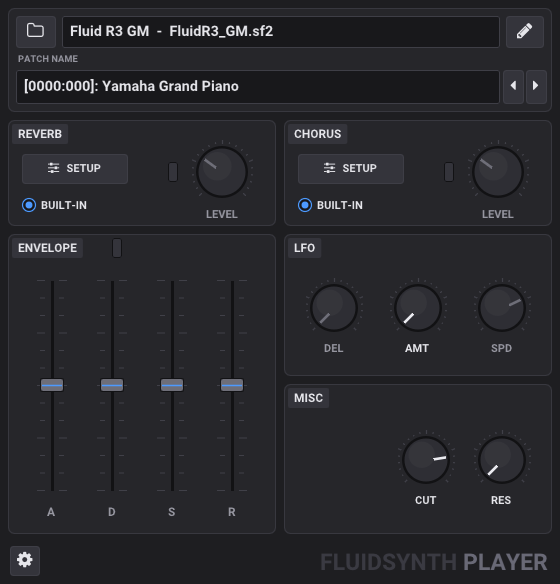

<TABLE CELLSPACING="0" CELLPADDING="0">
  <TR>
    <TH>
      <H1>FluidSynth Plugin for DAWs and Pedantic FluidSynth Command
          Line Processor</H1>
    <TH>
      
    </TH>
  </TR>
</TABLE>

## Overview

_[FluidSynth][]_ is one of the most prominent open source MIDI players.  It is reasonably flexible, delivers a good audio quality and is available for the typical platforms.  A common scenario is to use it for either rendering live MIDI data on some audio device or converting MIDI files into audio files by command-line batch processing.

Basis of <TT>FluidSynth</TT> are the so-called *SoundFonts*.  SoundFonts contain sampled instruments together with envelope and modulation definitions and other descriptive settings.  It is easy to find really usable ones in the internet and also several of those cover all general MIDI instruments (for example, the `FluidR3_GM.sf2`).

So when using <TT>FluidSynth</TT> in a command-line driven context all is well.  But when you want play around with settings for <TT>FluidSynth</TT> interactively in a DAW, you need some approximation of the command-line fluidsynth as a DAW plugin rendering audio from MIDI as close as possible to the original.

There were some previous efforts like Alexey Zhelezov's _[FluidSynthVST][]_ or Birch Labs' _[JuicySFPlugin][]_, but those are a bit tricky to use and support for them is unclear.  But the main point is that even though they rely on the <TT>FluidSynth</TT> library, they **do not exactly reproduce an external fluidsynth rendition of some MIDI data**.  Reasons for that will be explained below.

The reason for being picky about the exact rendering is as follows: my scenario is a command-line based rendering of notation videos for a band (the _[LilypondToBandVideoConverter][LTBVC]_).  Part of that chain is <TT>FluidSynth</TT>, but I want to experiment interactively with settings in a DAW to optimize the audio and then have a faithful reproduction of the external rendering pipeline within the DAW.

The first component of this package is a DAW plugin called <B><TT>FluidSynthPlugin</TT></B>.  It has a simplistic interface where you specify a SoundFont, several fluidsynth settings and possibly a MIDI program to be selected by putting text data in a text field.  Then you are able to convert an incoming MIDI stream in a DAW to audio using the FluidSynth library.

When playing around with that plugin some inexplicable differences to the command-line <TT>FluidSynth</TT> occured.  Even when using innocent SoundFonts (without chorus and other modulators), sample playback in the plugin and the command-line player were not absolutely identical.  Analysis and contact with the <TT>FluidSynth</TT> team revealed that in that program MIDI events are quantized onto some processing raster in the millisecond range while the plugin quantizes them onto the smallest time unit: the sample data point raster itself.

Hence another tool in this package circumvents the rasterization by the player of <TT>FluidSynth</TT>.  That second component is a simplistic but pedantic command-line converter called <B><TT>FluidSynthConverter</TT></B>.  It converts a MIDI file into a WAV file, is also based on the fluidsynth library and does the same data-point-exact event feeding into that library as the plugin.

When using both components (command-line and DAW) on the same MIDI data they typically produce audio output with a difference of less than -200dBFS in a spectrum analysis.

Those components are currently available - as x86_64 versions - for Windows and Linux as VST3, for MacOS as VST3 and AU for x86_64 and ARM64.

All the code is open-source; hence you can check and adapt it to your needs.

## CLAP Plugin with ImGui Interface (Linux and Windows)

Besides the original JUCE-based VST3/AU plugin, this fork contains a
**JUCE-free CLAP plugin**, `FluidSynthPlayer.clap`, with a Dear ImGui
interface over OpenGL2 - raw X11/GLX on Linux (the same GUI stack as the
sibling projects SfzDrummer and SoloSampler), Win32/WGL on Windows - in a
single compact panel (560x584, scales when resized):



- **SoundFont**: folder button (pop-up file chooser) or drag & drop a
  `.sf2` / `.sf3` / `.dls` file onto the window; the pencil button opens it
  in an external editor (configurable, e.g. Polyphone), right-click the
  name to reload/unload. Loading happens on a background thread and the new
  synthesizer is swapped in without blocking audio.
- **Patch name** `[bank:patch]: name` with prev/next arrows (and mouse
  wheel); clicking it opens the patch selector, a searchable list grouped
  by bank. `(none)` when the SoundFont lacks the patch, `(DrumKit)` for
  bank 128.
- **REVERB / CHORUS**: *ENABLE* switch, *Override Send* switch and send
  *LEVEL* knob; *SETUP* holds the effect unit parameters (reverb engine,
  room, damping, width / chorus voices, speed, depth).
- **ENVELOPE**: with its override switch on, the A/H/D/S/R faders replace
  the volume envelope of every new note (attack, decay and release times
  from 1 ms to 20 s, hold from 0 to 20 s, sustain level in dB); the preset
  keeps its own delay and modulation envelope.
- **LFO** (vibrato): with *AMT* at 0 each preset keeps its own vibrato;
  above 0, *AMT* (depth), *SPD* (speed) and *DEL* (delay) replace it.
- **MISC**: filter *CUT* (cutoff shift) and *RES* (added resonance) on top
  of the preset's own filter.
- **Options** (gear): volume, MIDI mode *Omni* / *Multitimbral (GM)* with a
  16-channel table, program change reception, bend range, transpose, fine
  tune, Poly/Mono/Legato, portamento, polyphony, interpolation, the raw
  FluidSynth settings of the original plugin, SoundFont info and the
  FluidSynth log.
- **UI size** (Options > General): 100% or 75% of the panel, for DAWs that
  can't resize plugin windows (the plugin asks the host for the new size);
  saved with the project, and new instances open at the last size chosen.
- Every control is a CLAP parameter (automation, gestures, text entry);
  MIDI events are placed sample-accurately as in the original plugin.
- **Restore MIDI controllers** (Options): some SoundFonts - e.g. converted
  E-mu EMAX II libraries - redefine the standard SF2 modulators with zero
  amounts, which per the spec disables CC7 volume, CC10 pan, CC11
  expression, CC91/93 sends, pitch bend, modulation or aftertouch. The
  plugin detects this on load (notice + list in Options/Info) and, with
  this option on, reinstates exactly those controllers on every voice.
  MIDI controller values also survive SoundFont reloads.
- The selected patch is saved with the DAW project and only an explicit
  MIDI Program Change moves it (GM/GS/XG reset SysEx no longer fall back
  to program 0). Options > Info lists every Program Change / Bank Select /
  reset message received, to track down a controller that sends them.
- **Default SoundFont** (Options > General, or right-click the SoundFont
  name > *Set as default*): loaded by every newly added instance; projects
  always reopen with their own saved SoundFont. Stored with the other
  global preferences in `~/.config/FluidSynthPlayer/config.txt`
  (`%APPDATA%\FluidSynthPlayer\config.txt` on Windows).

- **FluidSynth 2.6** (as in upstream FluidSynthPlugin 0.8.0): output
  limiter, reverb engines (Dattorro, FDN, Freeverb, Lexicon, Signalsmith -
  projects saved before keep 2.5's FDN), 11/17/25-point sinc
  interpolation and the portamento-time CC mode. **Render interpolation**
  (Options > General): the method used when the DAW renders/exports
  offline (CLAP `clap.render`) - 25-point sinc by default, as in
  upstream's "4;7" - while playback keeps the lighter one. Options > Info lists the
  version of every part (this plugin, the FluidSynthPlugin release it is
  based on, FluidSynth, libsndfile, CLAP, Dear ImGui); the CLAP
  description shown by the DAW includes them too.

FluidSynth 2.6.2 is vendored in `external/fluidsynth` (with the header-only
Signalsmith libraries in `external/signalsmith`) and linked statically, so
the `.clap` doesn't depend on the system's libfluidsynth version.

libsndfile is only needed for SF3 (Ogg/Vorbis compressed) SoundFonts: when
CMake doesn't find it, the plugin is built without SF3 support (with a
warning; SF2 and DLS keep working, Options > Info shows it).

**VST3**: the same build also produces `FluidSynthPlayer.vst3` from the very
same code through [clap-wrapper](https://github.com/free-audio/clap-wrapper)
(`external/clap-wrapper`) and the Steinberg VST3 SDK (`external/vst3sdk`,
only the parts clap-wrapper compiles) - nothing is downloaded. clap-wrapper
carries a local patch, `patches/clap-wrapper/`, that makes multitimbral
MIDI exact in VST3: without it, many controller and program change values
arrive one too low (program 40 as 39), and REAPER's program changes would
precede the bank select sent with them. The VST3 lands in `<build>/Release/` (or the
build directory); turn it off with `-DFSP_BUILD_VST3=OFF`.

### Linux

Needs CMake >= 3.24, `libsndfile1-dev`, X11/OpenGL headers; `zenity` at
runtime for the *Open...* dialog:

```sh
cmake -B build-clap
cmake --build build-clap -j$(nproc)
cp build-clap/FluidSynthPlayer.clap ~/.clap/
cp -r build-clap/Release/FluidSynthPlayer.vst3 ~/.vst3/   # VST3, optional
```

Distribution zip (`dist/FluidSynthPlayer-<version>-linux-<arch>.zip`, with a
README.txt and the licenses of every statically linked component; the
plugin uses the system's libsndfile, and runs on the glibc version it was
built against or newer):

```sh
sh scripts/package-linux.sh build-clap
```

### Windows

Needs CMake >= 3.24 and either Visual Studio 2022 (MSVC) or MinGW-w64
(GCC). The GUI uses only system libraries (Win32, OpenGL 1.1, comdlg32);
the C/C++ runtime is linked statically (`FSP_STATIC_RUNTIME`, on by
default), so the `.clap` is a single file with no DLLs to ship.

MSVC, with SF3 support through a static libsndfile from
[vcpkg](https://vcpkg.io) (the `x64-windows-static` triplet matches the
static runtime):

```bat
vcpkg install libsndfile:x64-windows-static
cmake -B build-win -A x64 -DCMAKE_TOOLCHAIN_FILE=%VCPKG_ROOT%\scripts\buildsystems\vcpkg.cmake -DVCPKG_TARGET_TRIPLET=x64-windows-static
cmake --build build-win --config Release
```

MinGW-w64 (e.g. MSYS2, scoop or winlibs GCC) with Ninja. For SF3 support,
first build a static libsndfile with vcpkg (Ogg/Vorbis/FLAC/Opus codecs,
no MP3 - SF3 only needs Vorbis), in PowerShell:

```powershell
$env:VCPKG_DEFAULT_HOST_TRIPLET = "x64-mingw-static"
vcpkg install "libsndfile[core,external-libs]:x64-mingw-static"
cmake -G Ninja -B build-win-sf3 -DCMAKE_BUILD_TYPE=Release -DCMAKE_C_COMPILER=gcc -DCMAKE_CXX_COMPILER=g++ -DCMAKE_TOOLCHAIN_FILE="$env:VCPKG_ROOT\scripts\buildsystems\vcpkg.cmake" -DVCPKG_TARGET_TRIPLET=x64-mingw-static
cmake --build build-win-sf3
```

Without vcpkg (no SF3 support):

```bat
cmake -G Ninja -B build-win -DCMAKE_BUILD_TYPE=Release -DCMAKE_C_COMPILER=gcc -DCMAKE_CXX_COMPILER=g++
cmake --build build-win
```

Distribution zip (`dist/FluidSynthPlayer-<version>-windows-x64.zip`, with a
README.txt and the licenses of every statically linked component, including
libsndfile and its codecs when built with vcpkg):

```powershell
powershell -ExecutionPolicy Bypass -File scripts\package-windows.ps1 -BuildDir build-win-sf3
```

Install by copying `FluidSynthPlayer.clap` into
`C:\Program Files\Common Files\CLAP\` (all users) or
`%LOCALAPPDATA%\Programs\Common\CLAP\` (current user). A libsndfile
that is a DLL (e.g. MSYS2's) also works, but then it and its codec DLLs
must be found by the *host* (next to the DAW's `.exe` or in `PATH`) - CMake
warns about it; prefer a static one.

On Windows the editor is a child window running on the host's UI thread
(redrawn from a timer), *Open...* uses the native file dialog, SoundFonts
can be dropped from Explorer, and the external editor is started through
the shell (a full path, or a name registered in "App Paths", e.g.
`polyphone`).

Test without a DAW (renders audio, checks params/state; `gui` opens the
window, `FLUIDSYNTHPLAYER_DEBUG_POPUP=patches|options|reverb` opens a popup
for screenshots; `test/clap/xdnd_drop.py` simulates a drag & drop onto it):

```sh
./build-clap/mini_host build-clap/FluidSynthPlayer.clap /usr/share/sounds/sf2/FluidR3_GM.sf2 [gui]
```

On Windows `mini_host.exe` does the same (`gui` embeds the editor in a
window of its own, like a DAW would); its checks assume a General MIDI
SoundFont such as FluidR3_GM, e.g. `test\SimpleTestSoundfont.sf2` passes
them all.

The sources live in `src/clap/`; the vendored FluidSynth (LGPL-2.1),
Signalsmith, CLAP headers, Dear ImGui, Font Awesome and Roboto (UI font,
Apache 2.0) in `external/`.

## Installation

The installation is as follows:

   1. Expand the appropriate binary archive of <TT>FluidSynthPlugin</TT> for your platform from this [repository](../../releases) into the directory for VST plugins of your DAW.

   2. The distribution also contains a documentation [pdf file](./FluidSynthPlugin-documentation.pdf) in subdirectory doc and test files in subdirectory test (for details on the regression test see below).

   3. Depending on your target operating system, additional steps might be necessary:
         
      - When installing the plugins on Linux, you have to ensure that the fluidsynth package is already installed (e.g.  with <TT>sudo apt install fluidsynth</TT>).

      - When installing the plugins on MacOS, note that those are *not signed*; so you have to explicitly remove the quarantine flag from them (e.g. by applying the command <TT>sudo xattr -rd com.apple.quarantine «vstPath»</TT>).

      - When installing the plugin and program on Windows, they require the so-called Microsoft Visual C++ Redistributable library.  Very often this is already installed on your system; if not, you have to install it from the [Microsoft][VCCLib] site.

   4. Restart your DAW and rescan the plugins.  You should now be able to select the <TT>FluidSynthPlugin</TT>.

   5. The command-line version <TT>FluidSynthFileConverter</TT> can be put in an arbitrary location for executables.  Ensure that the dynamic libraries in its directory are also placed appropriately.

## Usage

### FluidSynthPlugin


The above diagram shows the UI for the <TT>FluidSynthPlugin</TT>. It is very simplistic: a multiline edit field can be used for command entry. In this multiline field <TT>FluidSynth</TT> commands and some extension can be written (like e.g. `synth.chorus.active`, `synth.reverb.level` or `program`). Each command is on a single line followed by an equal sign and its associated value.

Edits have to be confirmed with the "Confirm"-button and then the audio output is active.

Note that the plugin listens to all MIDI channels, but is not multi-timbral (i.e. only a single sound can be produced as specified by the "program" setting or program changes within the MIDI event stream).

### FluidSynthFileConverter

The <TT>FluidSynthFileConverter</TT> is merely a functionally reduced clone of <TT>FluidSynth</TT>, but with a special property: it places MIDI events onto the raster given by the sample data point rate (as far as possible).

Similarly to <TT>FluidSynth</TT>, the <TT>FluidSynthFileConverter</TT> is a command-line program.  But the converter does not have to do real-time processing, so the list of its options is reduced, but it is a subset of the options of <TT>FluidSynth</TT>.  On top of that it only supports a conversion from a MIDI file into an audio file.

E.g. the command
```
fluidSynthFileConverter -g 1.0 -R 0 test.mid FluidR3_GM.sf2 -F test.wav
```
produces a wave file <TT>test.wav</TT> from MIDI file <TT>test.mid</TT> using sound font <TT>FluidR3_GM.sf2</TT> with reverb set to inactive and gain set to unity.

## Testing the Plugin and the Command-Line Processor

The test script <TT>makeTestFiles.bat</TT> or <TT>makeTestFiles.sh</TT> in the [test](./test) directory assumes that the <TT>FluidSynthFileConverter</TT> is available in the program search path.

The test script produces a sound file from a demo MIDI file.

Since there are so many DAWs available, it is hard to provide a test project for each of those.  The distribution contains a Reaper project file <TT>testFluidSynthPlugin.rpp</TT> referencing that audio test file and the originating MIDI file in two tracks.  Adaption to other DAW should be straightforward.

Ideally (because the result files have inverted phase), everything should cancel out as shown here:


## Restrictions

### Missing Timelocking Functionality

To be able to reproduce the phase of modulators in an external audio file within a plugin, one could use a parameter telling the **relative time of the plugin** with respect to the externally rendered audio.  While this method would lead to perfect reproduction of the external rendering, it is not feasible for the <TT>FluidSynthPlugin</TT>.  There is no direct way to set the modulators in the underlying <TT>FluidSynth</TT> library to a specific phase.  Another approach is to reset all modulators at playback start and first silently have the synthesizer process sample data points for some duration (to bring its modulators to the correct phases) before then finally putting out the "real" data points. But this is tedious, takes a lot of processing time and also does not help in a situation where the playback has to start **before** the start time of the corresponding fragment.

So when you need a bit-exact reproduction of externally rendered audio by the <TT>FluidSynthPlugin</TT>, some workaround has to be made as follows:

  - The selected instrument(s) in the SoundFont must not contain any (free-running) modulators.

  - Chorus must be deactivated (e.g. by setting `synth.chorus.active` to 0).

### Forced Rasterization by <TT>FluidSynth</TT>

As mentioned in the introduction the important difference between using the standard <TT>FluidSynth</TT> from the command-line versus from a DAW is that there is a forced rasterization to 64 sample data points' intervals.

Unfortunately this rasterization is not just done by <TT>FluidSynth</TT> when communicating with audio drivers or its file renderer, but also done internally by the fluidsynth synthesizer in the library.  The length of the smallest unit for which <TT>FluidSynth</TT> can make state changes and does buffering is a constant called `FLUID_BUFSIZE` and this is fixed to the value 64.

 - One could recompile the <TT>FluidSynth</TT> library and set this value to 1 but this would lead to a performance penalty and I wanted to rely on stock versions of <TT>FluidSynth</TT>.

 - Some intelligent buffering to adapt the rasters could be done, but this also did not work out well since the <TT>FluidSynth</TT> library cannot cope with resetting the synthesizer or flushing its data

As a workaround a script can help, when your DAW allows to change the loop interval and also the play head position via its API.  As an example a Lua script is provided for the Reaper DAW for demonstration purposes.

## Details

A more thorough discussion can be found in the detailed user manual *[here](./FluidSynthPlugin-documentation.pdf)*.

## Acknowledgements

This project is a derivative work based on the foundations laid by the FluidSynth community.

My thanks go to the FluidSynth team: Peter Hanappe, Conrad Berhörster, Antoine Schmitt, Pedro López-Cabanillas, Josh Green, David Henningsson and Tom Moebert.  Without your effort this would not have been possible!

Special thanks go to S. Christian Collins for very helpful discussions and his suggestions to improve the plugin, especially the great input to enhance the user interface beyond the original academic approach.

## License

There are two license models for this project:

  - The source code is provided with an [**MIT license**](./LICENSE.txt).

  - The VST and AU files given in the release are provided with an [**AGPL v3 license**](BINARY_LICENSE.txt) since they contain parts of the JUCE framework.

This means that if you do *not* use the given binaries and compile the source code by yourself, the MIT license applies.  If you *do* use the binaries, then the AGPL v3 license applies.

[FluidSynth]: https://www.fluidsynth.org
[FluidSynthVST]: https://github.com/AZSlow3/FluidSynthVST
[JUCE]: http://www.juce.com/
[JuicySFPlugin]: https://github.com/Birch-san/juicysfplugin
[LTBVC]: https://github.com/prof-spock/LilypondToBandVideoConverter
[VCCLib]: https://learn.microsoft.com/cpp/windows/latest-supported-vc-redist
